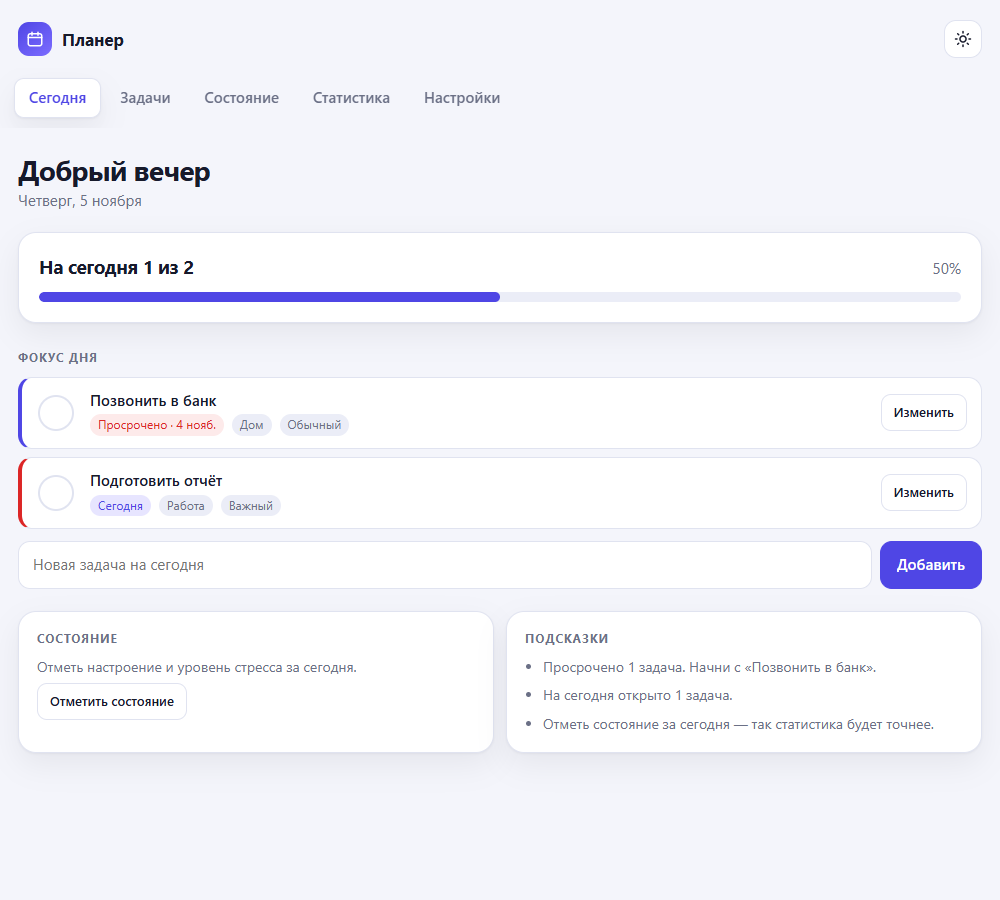
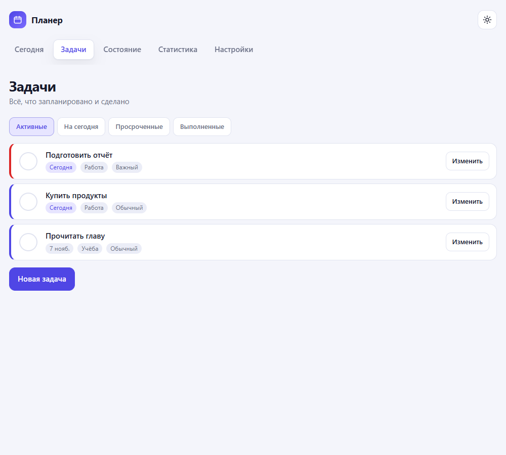
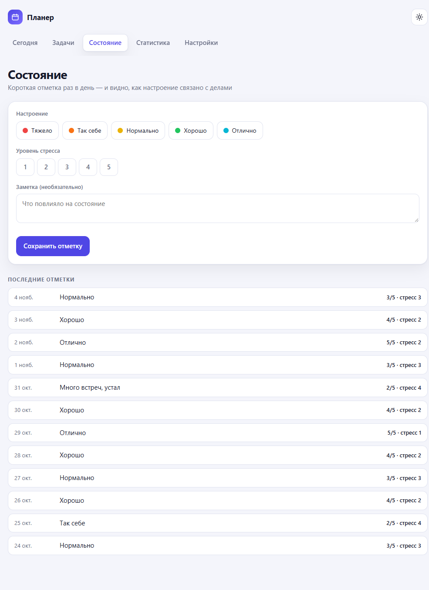
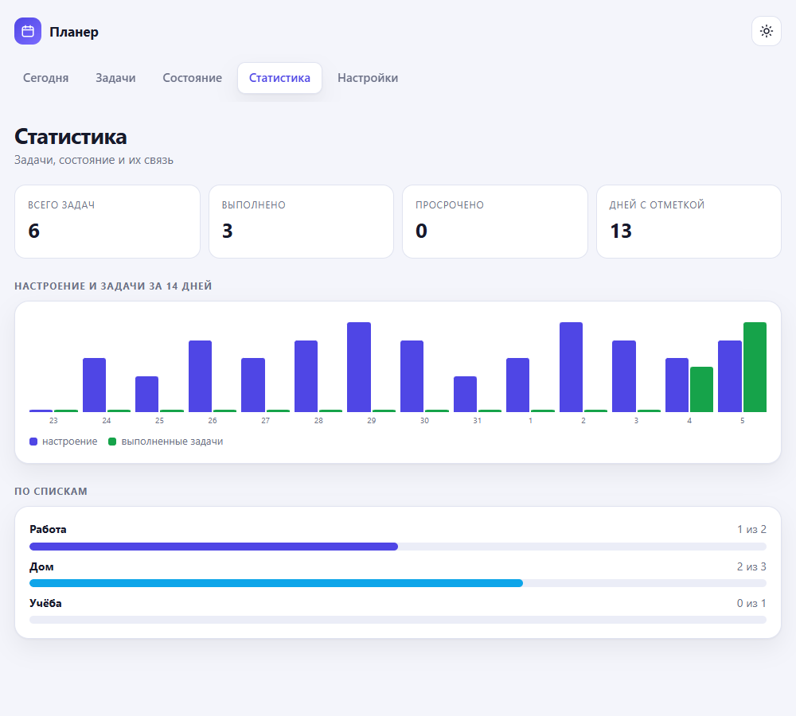
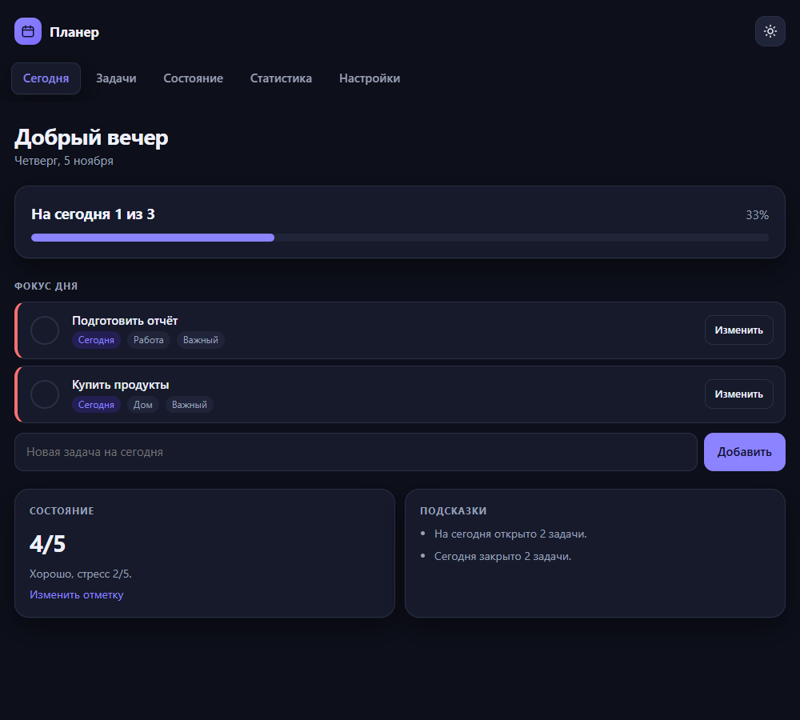
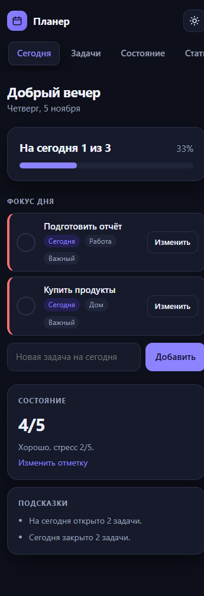

# Планер

Учебный MVP по кейсу №2: планировщик задач с дневником состояния. Без голосового
помощника — по требованию заказчика. Работает как устанавливаемое приложение (PWA),
данные хранятся в браузере.

## Ссылки

- Приложение: https://fatkullinar-eng.github.io/planner/
- Код: https://github.com/fatkullinar-eng/planner

Опубликовано на GitHub Pages. Нужны только статические файлы: `index.html`,
`styles.css`, `app.js`, манифест, service worker и иконки. `server.js` — для
локального запуска.

## Какая задача решается

Планы на день обычно живут в заметках и в голове: к вечеру непонятно, что
сделано и почему сил нет. Планер собирает задачи в одном месте, подсвечивает
просроченные и сегодняшние, а раз в день просит отметить настроение и уровень
стресса. Через две недели видно связь между нагрузкой и состоянием.

## Для кого

- **Тот, у кого много мелких задач** — работа, быт, учёба.
- **Тот, кто следит за состоянием** — отмечает настроение и стресс.
- **Учебный кейс** — показывает установку приложения на телефон и работу офлайн.

## Стек

- HTML, CSS, JavaScript без фреймворков.
- PWA: манифест и service worker, установка на телефон, работа без сети.
- Данные — в `localStorage`; публикация на GitHub Pages.

## Скриншоты

| Фокус дня | Задачи |
| --- | --- |
|  |  |

| Настроение и стресс | Статистика за 14 дней |
| --- | --- |
|  |  |

| Тёмная тема | Мобильная версия |
| --- | --- |
|  |  |

## Что умеет

- вести задачи: срок, приоритет, список, описание;
- показывать фокус дня: просроченные и сегодняшние задачи;
- отмечать настроение и уровень стресса раз в день;
- строить график «настроение и выполненные задачи» за 14 дней;
- давать короткие подсказки по правилам, без внешних сервисов;
- переключать светлую и тёмную темы;
- выгружать данные в JSON;
- устанавливаться на телефон и работать без интернета.

## Как запустить на компьютере

Нужен Node.js. В папке проекта открой PowerShell и выполни:

```
node server.js
```

Затем открой в браузере:

```
http://localhost:3000
```

Остановить сервер — Ctrl + C в том же окне.

## Как опубликовать на GitHub Pages

1. Загрузить папку в репозиторий GitHub.
2. В настройках репозитория открыть Pages и выбрать ветку `main`, папку `/`.
3. Через минуту приложение будет доступно по адресу `https://<логин>.github.io/<репозиторий>/`.

Сервер не нужен: приложение статическое. Файл `server.js` остаётся только для
локального запуска и на публикацию не влияет.

## Структура

```
planner/
  index.html            — разметка
  styles.css            — оформление и темы
  app.js                — логика
  manifest.webmanifest  — описание приложения для установки
  sw.js                 — офлайн-кеш
  icons/                — иконки 192 и 512
  server.js             — мини-сервер для локального запуска
  package.json          — команда запуска
  info/ТЗ.md            — техническое задание
```

## Ограничения MVP

- При первом запуске показываются демонстрационные задачи и отметки состояния,
  чтобы сразу было видно, как всё работает. Удалить их можно в настройках.
- Данные живут только в том браузере, где открыто приложение.
- Нет сервера, регистрации и синхронизации между устройствами.
- Совместные списки не реализованы.
- Подсказки — правила по данным, а не нейросеть.
- Голосовых функций нет: исключены по требованию заказчика.

После изменения файлов увеличьте версию `CACHE` в `sw.js`, иначе браузер
покажет старую версию из кеша.
